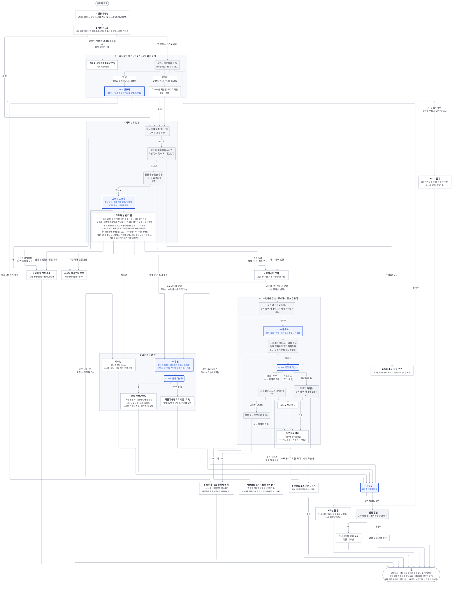
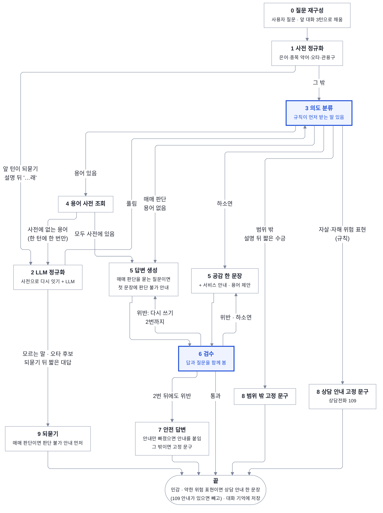
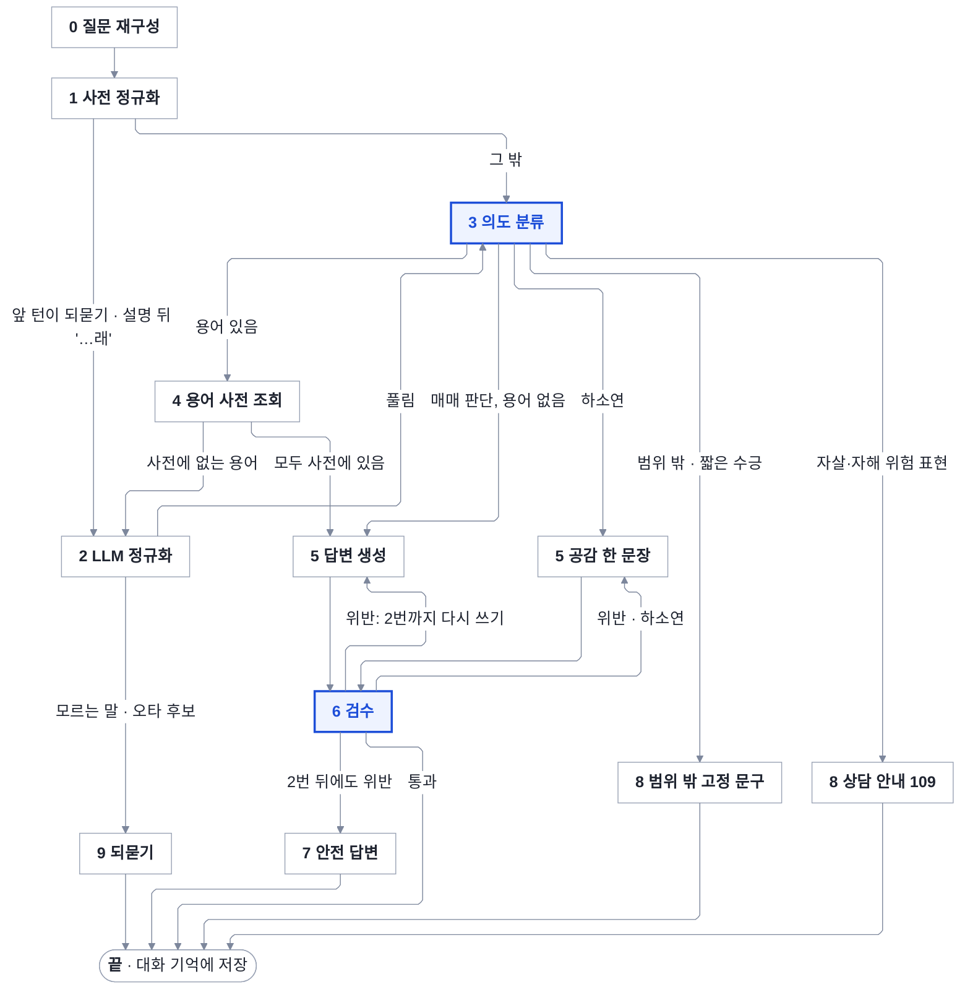
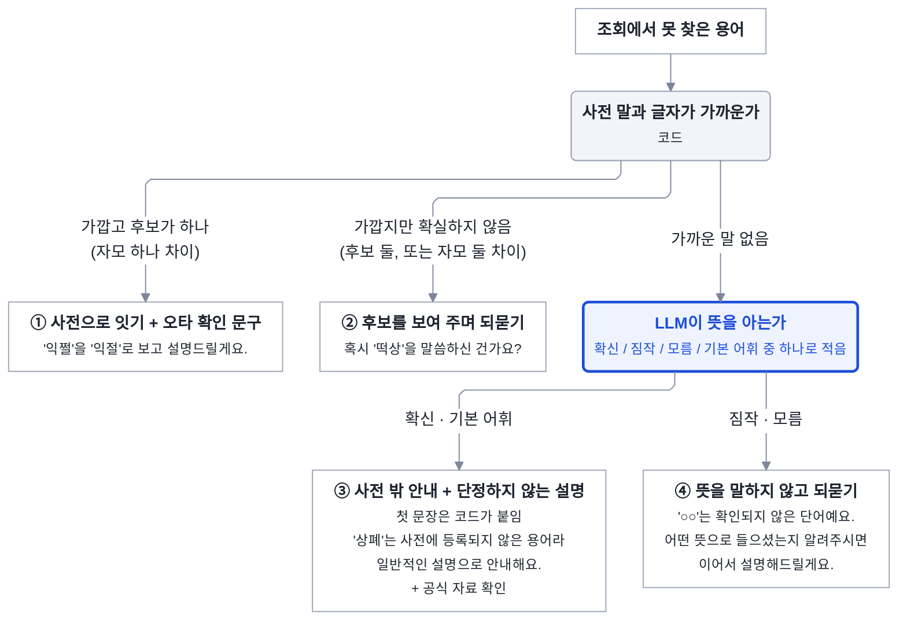
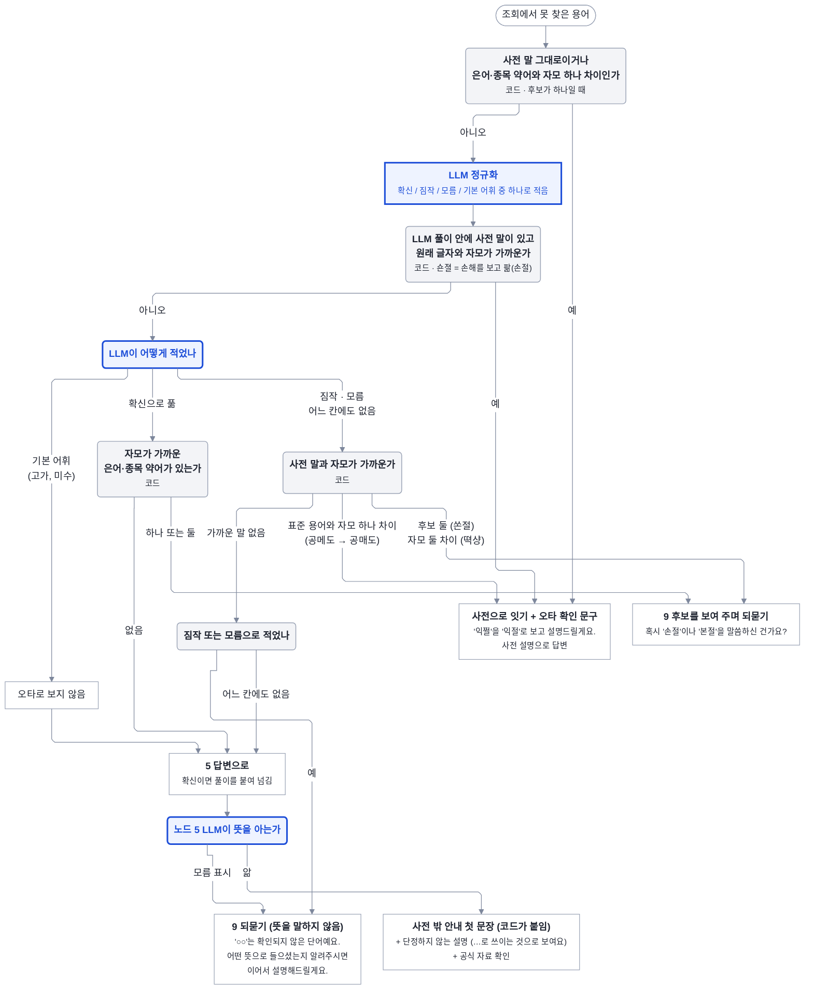
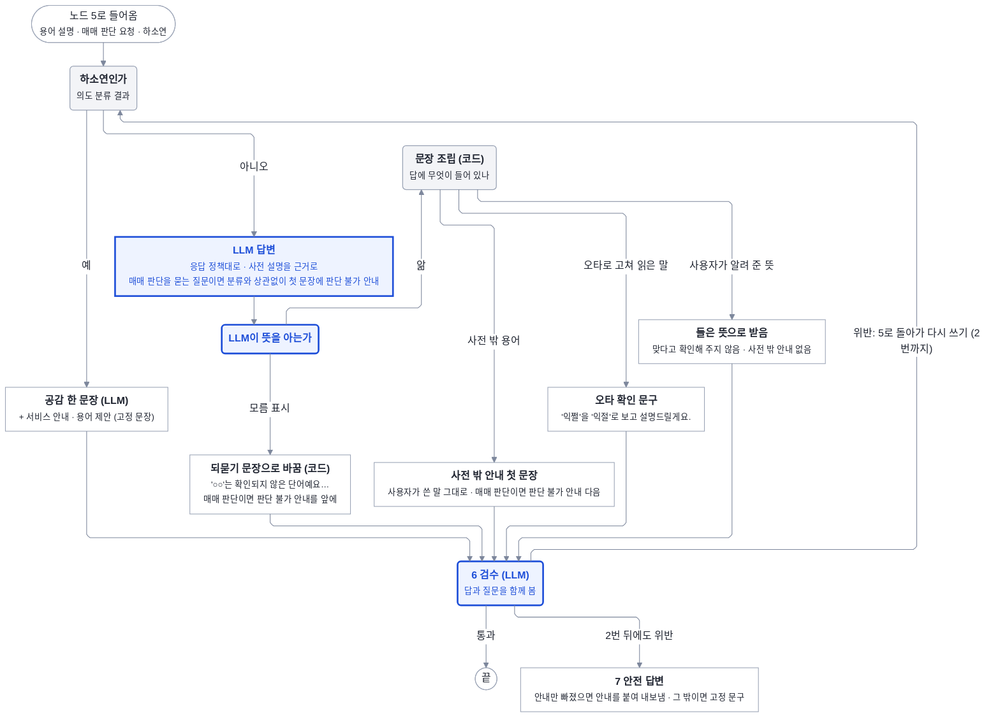
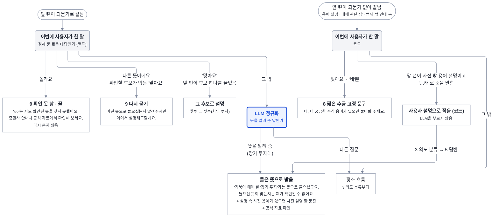

흐름 그림 원본 (2026.11.16, 고친 기록 P-097까지 들어간 코드 기준 · 최종 구성 D + 규칙 분류)

| 파일 | 그림 |
|---|---|
| flow_full | 전체본: 모든 분기를 한 장에 |
| flow_summary | 한 장 요약: 노드 단위 |
| flow_summary_slide | 한 장 요약의 슬라이드용 (칸 안 설명을 뺌) |
| flow_unknown_word | 사전에서 못 찾은 말의 네 갈래 (요약) |
| flow_unknown_word_detail | 사전에서 못 찾은 말 (코드 그대로) |
| flow_answer | 답변 생성 칸 안 |
| flow_after_ask | 되묻기 · 설명 뒤 다음 턴 |

- 파란 칸은 LLM이 판단해 길이 갈리는 곳, 회색 칸은 코드가 가르는 곳, 흰 칸은 하는 일과 나가는 문장
- 다시 그리기 (mermaid-cli 11): `mmdc -i flow_full.mmd -o flow_full.png -c mermaid_config.json -C mermaid_style.css -s 2 -b white -w 2000`
- 슬라이드용은 `-c mermaid_config_slide.json -w 1600`

---

**GitHub 그림으로 보기**

아래는 같은 원본(.mmd)을 GitHub가 직접 그린 그림입니다. 그림 오른쪽 아래 버튼으로 확대 · 이동할 수 있습니다. PNG는 위 표의 파일 그대로입니다.

**flow_full** · 전체본: 모든 분기를 한 장에 ([PNG](flow_full.png))

**flow_summary** · 한 장 요약: 노드 단위 ([PNG](flow_summary.png))

**flow_summary_slide** · 한 장 요약의 슬라이드용 (칸 안 설명을 뺌) ([PNG](flow_summary_slide.png))

**flow_unknown_word** · 사전에서 못 찾은 말의 네 갈래 (요약) ([PNG](flow_unknown_word.png))

**flow_unknown_word_detail** · 사전에서 못 찾은 말 (코드 그대로) ([PNG](flow_unknown_word_detail.png))

**flow_answer** · 답변 생성 칸 안 ([PNG](flow_answer.png))

**flow_after_ask** · 되묻기 · 설명 뒤 다음 턴 ([PNG](flow_after_ask.png))

